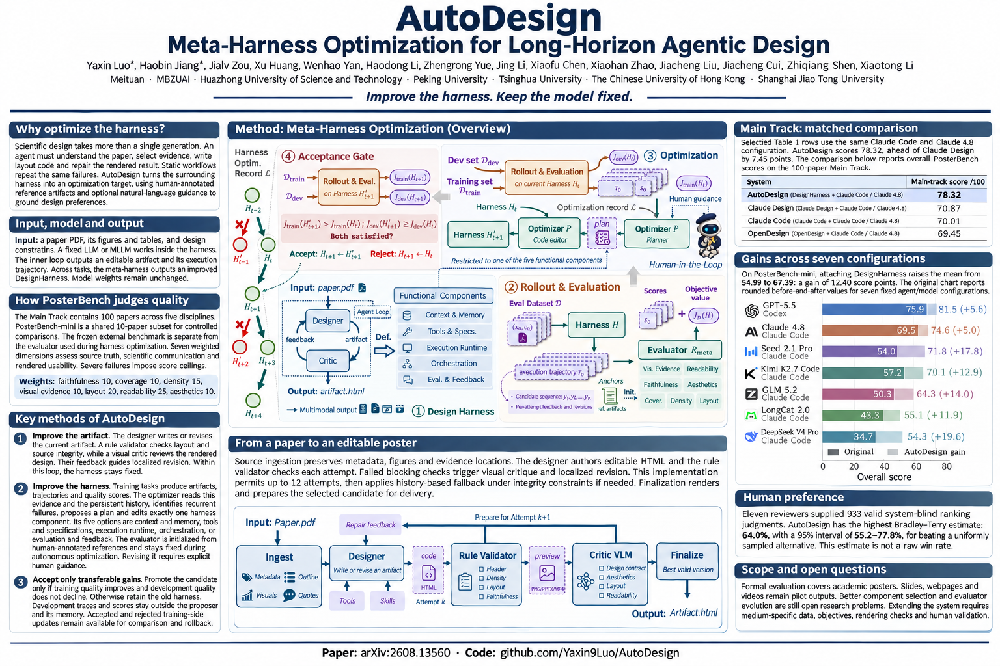
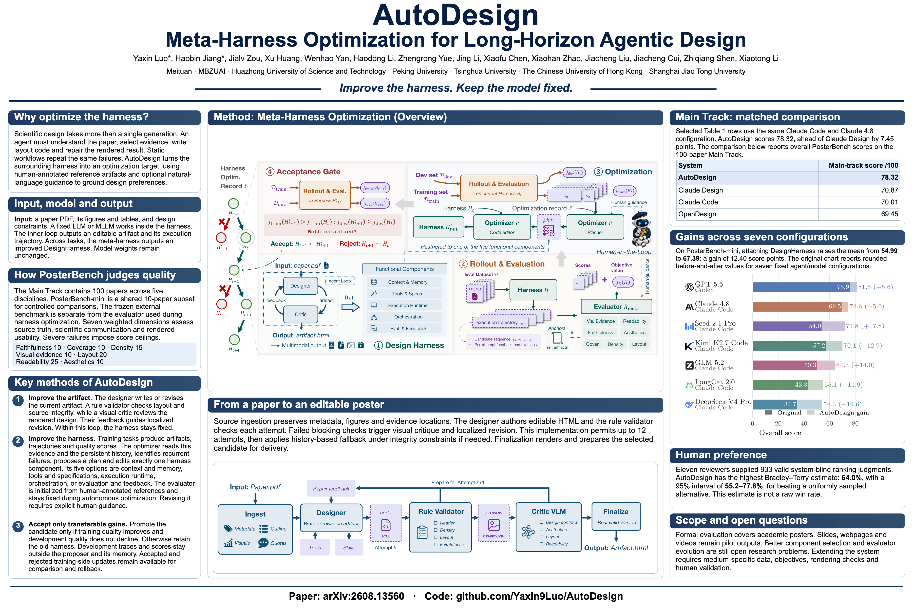
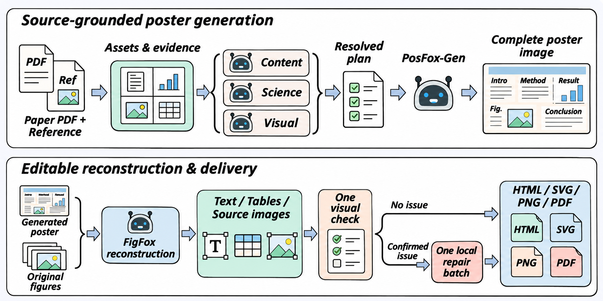

# PosFox

从论文 PDF 生成海报，再重建为可编辑的 HTML / SVG，导出 PNG / PDF。

这套 workflow 在当前 agent Harness 中执行：模型负责阅读、讨论、图生成和视觉判断，本地 Python 负责素材提取、文件构建、渲染与校验。需要 Harness 提供图生成能力；单独执行 Python 不会自动生成海报。

## 流程

1. 解析完整论文，提取保留图例、坐标轴和出处的图表素材，记录 PDF 点尺寸、真实像素和宽高比，并把尺寸及预期显示框传给图生成阶段。
2. 内容、科学核查、视觉规划三个角色并行阅读同一份材料；必要时围绕争议做一次简短回调，由主执行者落实修改。
3. 优先采用用户给出的主参考，生成包含完整正文和图表的海报图。生成阶段已包含在主流程中，使用仓库内的[生成规则](skills/posfoxgen/references/prompt-rules.md)。
4. 重建前冻结真实生成图的视觉清单，保留所有可见模块（包括正文重复的模块）、面积／文字占比、配色和圆点／结构线；按生成图重建可编辑 HTML / SVG，使用论文原图和准确数值替换生成近似；重建与局部修复参考 [FigFox](https://github.com/LawrenceRiver/FigFox)。
5. 用干净 paired crops 和独立红笔批注逐模块做一次语义窗口对照。模块遗漏、位置／面积／文字占比变化、错误颜色和丢失圆点／线条均进入同一批局部修复，再验证受影响对象与导出文件；全部检查通过且无问题时才直接交付。
6. 保留来源、实际审阅记录、阶段耗时和校验结果，交付 HTML、SVG、PNG、PDF。

图生成通常一次，必要时最多重生成一次；未解决的实质错误会阻塞交付。文字、线条和原生表格可编辑；保留为论文原图的图像对象可移动、替换，其内部标签不会自动变成独立文字。

## 安装与使用

```sh
git clone https://github.com/jason0917-eng/PosFox.git
cd PosFox
python3 -m venv .venv
source .venv/bin/activate
python -m pip install -e .
```

将 `skills/posfoxgen` 注册到 Harness 的 skills 目录。例如在 Codex 中，从仓库根目录执行：

```sh
mkdir -p ~/.codex/skills
ln -s "$PWD/skills/posfoxgen" ~/.codex/skills/posfoxgen
```

如果同名 Skill 已存在，先检查其位置。随后在新会话中调用 `$posfoxgen`，提供论文 PDF 和可选的设计参考。模型阶段使用 Harness 当前能力，无需额外搭建模型 API 服务或配置本项目专用 API key。

Skill 入口：[SKILL.md](skills/posfoxgen/SKILL.md)。阶段命令与文件契约：[workflow.md](skills/posfoxgen/references/workflow.md)。

只需安装本仓库并调用同一个 `$posfoxgen`，流程会从论文解析、讨论和海报图生成继续到可编辑重建与导出。无需另装生成版 Skill，也无需在中途切换 Skill。若本机已有同名的旧生成版安装，先备份，再将该入口切换到本仓库的 `skills/posfoxgen`；不要覆盖其他本地修改。

```sh
python skills/posfoxgen/scripts/run.py --help
python skills/posfoxgen/scripts/run.py init --run runs/example --paper /absolute/paper.pdf --split development
python skills/posfoxgen/scripts/run.py assets /absolute/paper.pdf --out runs/example/source
python skills/posfoxgen/scripts/run.py status --run runs/example
python skills/posfoxgen/scripts/run.py validate-delivery --run runs/example
```

`assets`、`editable` 和 `render` 是本地文件工具，不会代替模型完成科学判断。阶段收据记录实际输入与输出，最终校验会重新检查文件、来源绑定、渲染报告与审阅记录。

新运行默认使用 `posfoxgen-v3`，强制源图尺寸交接和重建前冻结的视觉清单。重复模块不能共用同一原生对象来冒充覆盖；对照窗、红笔图和来源清单须绑定真实文件哈希并随最终包保留。原图按真实宽高比等比放置，仅能解释图片自身的包络变化，不能豁免周围模块、配色、文字占比或圆点的丢失。显式 v1/v2 保留历史兼容，不自动获得新版保真结论。完整合同见 [visual-fidelity.md](skills/posfoxgen/references/visual-fidelity.md)。

## 可选附加包：只生成海报 PNG

完整流程继续使用 `$posfoxgen`。如果只需要科研海报图，可以单独安装同仓库中的 [PosFox Gen](skills/posfox-gen/SKILL.md)：

```sh
npx skills@latest add jason0917-eng/PosFox --skill posfox-gen
```

调用 `$posfox-gen` 并明确说明要做科研海报，提供论文 PDF 和可选海报参考。它包含独立的 PDF 素材提取工具，生成 PNG 后结束，不进入 HTML/SVG 重建，也不会覆盖完整流程入口。私有仓库安装需要相应的 GitHub 访问权限。

这个附加包只用于明确的科研/学术海报请求。普通科研论文插图、方法图、架构图仍走论文图生成流程，不因输入了 PDF 或参考图就转为海报。

## 渲染与可选修复引擎

渲染需要本机 Chrome / Chromium。未自动找到时，用 `POSFOXGEN_CHROMIUM` 指定可执行文件。字体也需要本地安装；工具会检查实际字体与文字溢出。

使用 FigFox 原生局部编辑桥接器或运行其集成测试前，下载固定版本源码：

```sh
git clone https://github.com/LawrenceRiver/FigFox.git vendor/figfox
git -C vendor/figfox checkout 21ffc01271904d6c5610f0f96afd84530968f11e
```

桥接器仅加载确定性的原生编辑合同，不调用上游模型 API。其余研究来源的版本见 [vendor/sources.json](vendor/sources.json)。

## 参考与检查

生成前的逻辑与证据核查、原图保留、可编辑重建和局部修复是本流程的主要约束。海报规划与质量诊断也参考了 [AutoDesign](https://github.com/Yaxin9Luo/AutoDesign)、[Paper2Poster](https://github.com/Paper2Poster/Paper2Poster) 和 [FigFox Gen](https://github.com/LawrenceRiver/FigFox-Gen-skill)。来源和适用边界见 [质量研究记录](references/poster-quality-research.md)。

仓库只附轻量参考清单，作者海报原件按视觉参考用途单独下载：

```sh
python scripts/reference_library.py
python scripts/reference_library.py --verify-only
```

原作者海报的内容和许可归各自作者；清单不授予图片再分发权。本地七维质量判断与官方 PosterBench 执行分开记录，单个演示不作为稳定速度或泛化效果的证据。

开发检查：

```sh
python -m pip install pytest
python -m pytest -q
```

完整测试需要上述浏览器、常用字体及固定 FigFox 源码。用户论文、海报原件、缓存、运行记录和个人开发笔记不随源码发布。


## 示例：AutoDesign 论文 → 可编辑海报

以 [AutoDesign 论文](https://arxiv.org/abs/2608.13560)为例：先从原文提取方法、实验图表和主张依据，围绕研究问题、输入输出、方法与结果安排正文，再生成整张海报图。重建时保留设计结构，把正文、分隔线和结果表格转成原生对象，并用论文原图替换生成图中的近似图表。

| 图生成结果 | 可编辑重建结果 |
| --- | --- |
|  |  |

中间两张流程图已恢复原始宽高比。正文和表格可逐项修改，论文图作为保留比例的图像对象移动、缩放或替换。

[可编辑 SVG](examples/autodesign/poster.svg) · [HTML 源文件](examples/autodesign/poster.html) · [PDF](examples/autodesign/poster.pdf) · [完整预览](examples/autodesign/poster.png)

这是 PosFox 根据该论文制作的流程演示；图表和研究结果归原论文作者。生成图用于设计引导，最终科学内容以论文原图与核对后的数值为准。

### 流程节奏参考

下面借用 **FigFox 论文另一轮试跑**的记录说明阶段衔接，共 **11 分 51 秒**。它不是上方 AutoDesign 示例的耗时，也不是固定速度承诺。该次 Skill、质量准则和参考已缓存，计时包含实际编排、工具处理与验证。

| 阶段 | 用时 |
| --- | --- |
| 素材准备与三角色讨论（并行） | 3:52 |
| 完整海报图生成 | 2:36 |
| 可编辑重建与初次渲染 | 2:23 |
| 视觉对照与一批局部修复 | 1:34 |
| 导出、校验与打包 | 1:26 |

该轮是历史 v2 试跑，使用三份并行初始报告、一次图生成和一批局部修复。用户随后指出该轮仍有重复模块删除、垂直占比变化及橙色标记遗漏；v3 已更新检查与修复合同，但尚未重跑该海报，不能把历史通过收据视为新版视觉保真通过。[计时来源与阶段边界](examples/figfox-timing-reference.json)。

## 流程图



上层完成基于论文证据的海报图生成；下层重建原生对象，做一次视觉检查，按需局部修复并导出。流程图使用 FigFox Gen 生成。
